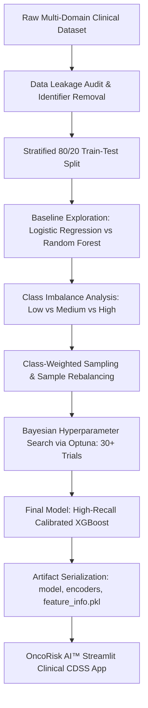

# 🧬 OncoRisk AI™ — Clinical Oncology Risk Stratification Platform

<p align="center">
  
  
  
  
  
  
</p>

---

## 📌 Executive Summary

**OncoRisk AI™** is an end-to-end **Clinical Decision Support System (CDSS)** developed to stratify and triage multi-cancer risk tiers (**Low**, **Medium**, **High**) based on patient biomarkers, genetic predisposition, lifestyle indices, and occupational-environmental hazards.

Designed with a **clinical-first safety paradigm**, the system prioritizes **high-sensitivity recall** to ensure patients at elevated risk are not missed, while guarding against false assurance. It translates raw multi-domain patient inputs into intuitive risk metrics, multidimensional radar decompositions, and actionable, evidence-based triage recommendations.

---

## 🎯 Supported Cancer Sites

The platform calibrates evaluations across 5 major cancer specializations:
- 🎗️ **Breast Cancer** (BRCA mutation, age, family history, hormone dynamics)
- 🔬 **Colorectal Cancer** (H. Pylori, high red/salted meat consumption, dietary fiber)
- 🫁 **Lung Cancer** (Tobacco exposure index, occupational hazards, particulate pollution)
- 🛡️ **Prostate Cancer** (Metabolic indices, age distribution, lifestyle risk)
- ☀️ **Skin / Melanoma** (Environmental hazards, age, genetic profile)

---

## 🔬 Machine Learning Architecture & Development Journey

The training methodology follows a rigorous, leak-free iterative ML engineering pipeline documented in [`Cancer_Risk_Prediction.ipynb`](Cancer_Risk_Prediction.ipynb):



### 1. Leakage-Free Design
Derived aggregate metrics (e.g., target-derived risk composite scores) and high-cardinality patient identifiers were systematically audited and removed to ensure zero data leakage.

### 2. Overcoming Extreme Class Imbalance
High-risk oncology cohorts often represent a minority fraction in general screening datasets. Rather than defaulting to accuracy-based metrics, the model was optimized using:
- **Sample Weights**: Dynamically balancing error penalties inversely proportional to class frequencies.
- **Blended High-Recall Objective**:
  $$\text{Loss Objective} = 0.5 \times \text{Macro F1} + 0.5 \times \text{High-Recall}$$
  This explicitly forces the optimizer to minimize false negatives on high-risk cases.

### 3. Hyperparameter Tuning with Optuna
The final **XGBoost Classifier** was fine-tuned using Bayesian optimization over:
- `max_depth` & `learning_rate`
- Tree regularization: `reg_alpha` ($L_1$) and `reg_lambda` ($L_2$) to prevent tabular overfitting
- Subsample & column subsampling ratios (`colsample_bytree`)

---

## 📊 Feature Taxonomy & Risk Domains

The predictive engine ingests 18 clinical, behavioral, and environmental indicators structured across 5 distinct domains:

| Clinical Domain | Features Included | Measurement Scale |
| :--- | :--- | :--- |
| **👤 Demographics & Metabolic** | Age, Gender, BMI, Obesity Index | Continuous / Clinical Scale (0–10) |
| **🧬 Genetics & Biomarkers** | BRCA1/2 Mutation, Family History, H. Pylori Status | Binary Flags (0/1) |
| **🚬 Carcinogenic Substances** | Tobacco Smoking Index, Alcohol Use Burden | Frequency & Intensity Scales (0–10) |
| **🥗 Dietary Balance** | Red Meat Consumption, Salted/Processed Foods, Fruit/Veg Intake, Calcium | Quantitative Dietary Indices (0–10) |
| **🏭 Environmental & Workplace** | Ambient Air Pollution, Occupational Chemical Hazards, Physical Activity | Exposure & Activity Indices (0–10) |

---

## ✨ Clinical UI & Decision Support Features

The Streamlit interface (`app.py`) is styled with custom **Health-Tech Glassmorphism** design tokens:

- **Interactive Clinical Tabs**: Parameter entry grouped into clinical domains with real-time interpretation captions.
- **Composite Risk Index Gauge**: Visual needle gauge displaying composite 0–100 risk score and associated risk bracket.
- **Categorical Probability Bar Chart**: Complete posterior probability distribution across Low, Medium, and High risk.
- **5-Axis Multidimensional Radar Plot**: Decomposes patient risk into domain-level burdens against standard benchmarks.
- **Explainable AI (Top Risk Drivers)**: Highlights patient-specific levers most heavily influencing elevated risk.
- **Evidence-Based Clinical Guidance**: Generates personalized surveillance schedules, biomarker recommendations, and specialist referral workflows.
- **Medical Report Generator**: One-click generation and export of a clean plain-text clinical consultation record.

---

## 📁 Repository Structure

```plaintext
Cancer_Risk_Prediction/
│
├── artifacts/                           # Serialized production inference assets
│   ├── model.pkl                        # Optuna-tuned, class-weighted XGBoost model
│   ├── feature_info.pkl                 # Feature orders, data types, and value bounds
│   ├── label_encoders.pkl               # Encoders for categorical predictors
│   └── target_encoder.pkl               # Target label mappings (High, Low, Medium)
│
├── app.py                               # Full Streamlit Clinical Decision Support System
├── requirements.txt                     # Production dependency specifications
├── Cancer_Risk_Prediction.ipynb         # Full ML training, tuning & evaluation notebook
├── ML_Project_Knowledge (code,theory).md # Comprehensive theory & cell-by-cell walkthrough
└── README.md                            # Project documentation
```

---

## ⚡ Quickstart Guide

### 1. Prerequisites
Ensure you have **Python 3.10** or **3.11** installed on your system.

### 2. Clone the Repository
```bash
git clone https://github.com/<your-username>/Cancer_Risk_Prediction.git
cd Cancer_Risk_Prediction
```

### 3. Create & Activate Virtual Environment
```bash
# Windows (PowerShell)
python -m venv .venv
.venv\Scripts\Activate.ps1

# Linux / macOS
python3 -m venv .venv
source .venv/bin/activate
```

### 4. Install Dependencies
```bash
pip install -r requirements.txt
```

### 5. Launch the Clinical Platform
```bash
streamlit run app.py
```
The application will open automatically in your browser at `http://localhost:8501`.

---

## ☁️ Deployment Guide (Streamlit Community Cloud)

1. Push this repository to your GitHub account.
2. Visit [share.streamlit.io](https://share.streamlit.io/) and log in with GitHub.
3. Select **"Create app"** > **"Repository"**.
4. Configure deployment options:
   - **Repository**: `<your-username>/Cancer_Risk_Prediction`
   - **Branch**: `main`
   - **Main file path**: `app.py`
5. Click **Deploy!**

---

## ⚖️ Clinical & Ethical Disclaimer

> [!CAUTION]
> **Not a Standalone Medical Diagnostic Device:**
> OncoRisk AI™ is an investigative Machine Learning Clinical Decision Support tool built for triage prioritization, educational reference, and multi-factor risk assessment. It is **not** a replacement for histological biopsies, medical imaging (mammography, CT/MRI, colonoscopy), or professional clinical consultation. All diagnostic determinations must be made by qualified healthcare professionals.

---

## 📄 License & Attribution

This project is open-source under the **MIT License**. Contributions, issues, and feature requests are welcome!
